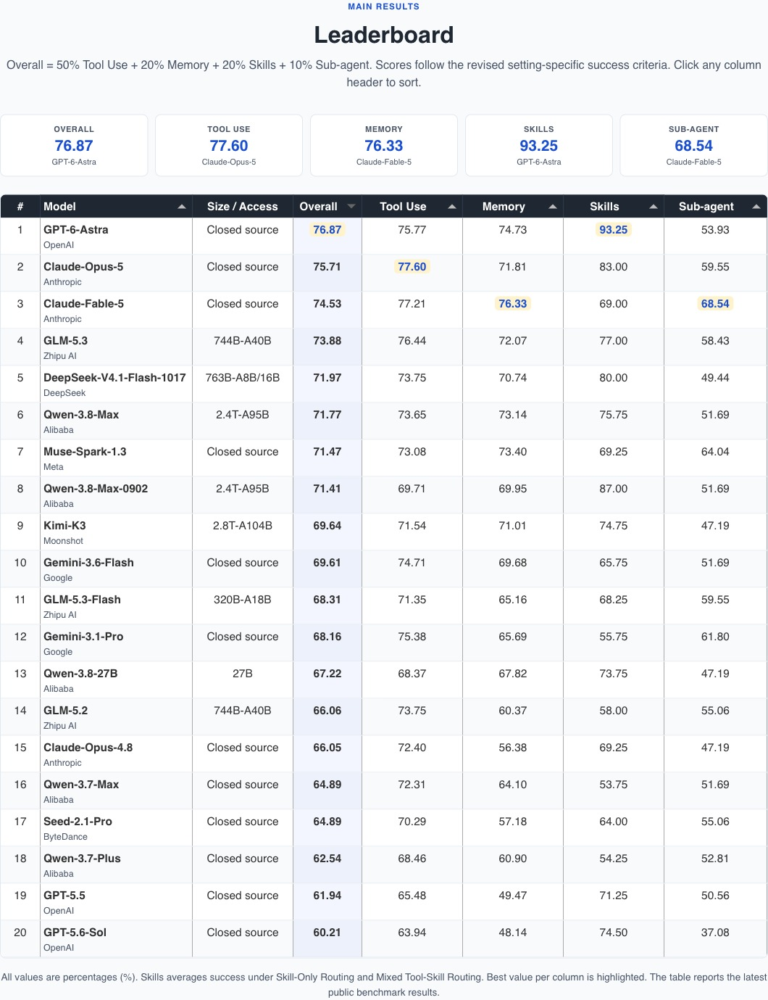
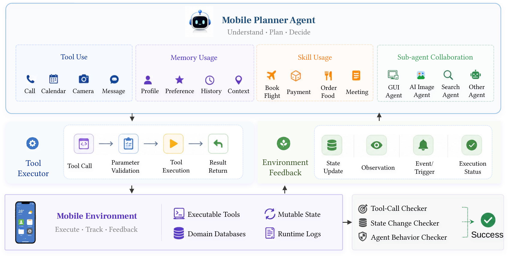

<div align="center">

# MobilePA-Bench

### Benchmarking Mobile Planner Agents on Complex Real-World Tasks

[Project Page](https://tongyi-mai.github.io/MobilePA-Bench/) ·
[Leaderboard](https://tongyi-mai.github.io/MobilePA-Bench/#leaderboard) ·
[Paper](https://tongyi-mai.github.io/MobilePA-Bench/MobilePA-Bench.pdf) ·
[arXiv](https://arxiv.org/abs/2608.23035) ·
[Hugging Face](https://huggingface.co/papers/2608.23035) ·
[Private Evaluation](https://116.62.42.171/login?next=/submit) ·
[Issues](https://github.com/Tongyi-MAI/MobilePA-Bench/issues)

[](https://arxiv.org/abs/2608.23035)
[](https://github.com/Tongyi-MAI/MobilePA-Bench/actions/workflows/deploy-pages.yml)
[](https://github.com/Tongyi-MAI/MobilePA-Bench/commits/main)
[](LICENSE)

</div>

**MobilePA-Bench** evaluates central mobile planner agents that coordinate structured tools, persistent user context, reusable skills, and specialized sub-agents. Its stateful simulated environment executes every action and records the resulting calls, state changes, and observable behavior, allowing task completion to be evaluated together with capability-specific requirements.

## Main Results

<p align="center">
  <a href="https://tongyi-mai.github.io/MobilePA-Bench/#leaderboard">
    
  </a>
</p>

- No model leads all four capability dimensions; the full capability vector is therefore more informative than Overall alone.
- Sub-agent Collaboration has the lowest cross-model mean (**53.71%**), while Skill Usage has the widest observed range (**39.50 points**).
- An exploratory online-RL checkpoint initialized from Qwen-3.8-27B improves Overall from **66.94%** to **69.25%** (**+2.31 points**) in the same sandbox.

## Highlights

- **Unified capability coverage:** Tool Use, Memory Usage, Skill Usage, and Sub-agent Collaboration are evaluated through a shared mobile protocol.
- **Executable and stateful:** 212 mobile tools operate over mutable application records, dependencies, and structured runtime feedback.
- **Evidence-aligned verification:** every query is assigned a fixed Tool Call, State Change, or Agent Behavior checker according to its completion semantics.
- **Capability-gated evaluation:** Memory tasks enforce annotated retrieval and action requirements; Skill-Only Routing requires a complete skill route before business-tool use.
- **Diagnostic scale:** 1,705 distinct queries span eight descriptive query domains and 30 subclasses, producing 1,905 scored trajectories per model.
- **Broad model study:** 20 open- and closed-weight frontier LLMs are evaluated with the same reference harness and function-calling interface.
- **Planner development:** the same sandbox supports online reinforcement learning; an exploratory Qwen-3.8-27B checkpoint improves Overall by 2.31 percentage points.

## News

- **2026-10-21:** Expanded the public leaderboard to 20 models and synchronized the project page and README results.
- **2026-10-19:** Updated the [project page](https://tongyi-mai.github.io/MobilePA-Bench/), [leaderboard](https://tongyi-mai.github.io/MobilePA-Bench/#leaderboard), and documentation for the revised [paper](https://tongyi-mai.github.io/MobilePA-Bench/MobilePA-Bench.pdf), including evidence-aligned verification, capability gates, 1,905 scored trajectories per model, expanded frontier-model analysis, and an exploratory online-RL baseline.
- **2026-08-25:** The project repository was opened with an interactive [project page](https://tongyi-mai.github.io/MobilePA-Bench/), [leaderboard](https://tongyi-mai.github.io/MobilePA-Bench/#leaderboard), and a [private-evaluation link](https://116.62.42.171/login?next=/submit).
- **2026-08-24:** The [MobilePA-Bench paper](https://arxiv.org/abs/2608.23035) was released on arXiv.

## Overview

MobilePA-Bench models a central mobile planner operating through structured tools, persistent memory, reusable skills, and specialized sub-agents. The simulated environment maintains application records and operational logs, enforces dependencies and argument rules, and returns structured feedback after every action.

The evaluator assigns each query one fixed primary checker: **Tool Call** for deterministic operational requirements, **State Change** when multiple valid paths reach the same outcome, or **Agent Behavior** for routing, handoff, clarification, and user-facing interaction. Memory and SOR Skill tasks additionally apply capability gates, separating missing resource or procedural requirements from downstream execution failures.

<p align="center">
  
</p>

### Capability Dimensions

| Dimension | What it measures |
| --- | --- |
| [Tool Use](https://tongyi-mai.github.io/MobilePA-Bench/#tool-use-examples) | Tool and parameter grounding, dependency planning, state tracking, intent revision, boundary handling, and error recovery |
| [Memory](https://tongyi-mai.github.io/MobilePA-Bench/#memory-examples) | Retrieval and maintenance of persistent user context together with compliant downstream task execution |
| [Skills](https://tongyi-mai.github.io/MobilePA-Bench/#skill-examples) | Task completion under Skill-Only Routing and Mixed Tool-Skill Routing, with route loading required only in SOR |
| [Sub-agent](https://tongyi-mai.github.io/MobilePA-Bench/#sub-agent-examples) | Planner-side routing, contextual handoff, and follow-up with GUI, image, search, and other specialized agents |


## Private Evaluation

We offer a confidential evaluation track for hosted mobile planner agents. Submit an HTTPS, OpenAI-compatible endpoint with tool-calling support, and MobilePA-Bench will evaluate the model across Tool Use, Memory Usage, Skill Usage, and Sub-agent Collaboration. To participate, [request a private evaluation](https://116.62.42.171/login?next=/submit) through our secure submission portal.

- **Confidential by design:** submissions go directly to the dedicated evaluation server; API credentials are never handled by GitHub Pages.
- **Hidden-test integrity:** benchmark queries, ground truth, and judge credentials remain isolated from submitted models.
- **Reviewed results:** each completed run is checked before its report is released to the submitting account.
- **Expected turnaround:** reports are normally returned within three business days, with one request allowed per account every seven days.

## Citation

If you find MobilePA-Bench useful in your research, please cite our paper:

```bibtex
@article{zhu2026mobilepabench,
  title         = {MobilePA-Bench: Benchmarking Mobile Planner Agents on Complex Real-World Tasks},
  author        = {Zhu, Yi and Wu, Xiongwei and Wang, Qiyi and Qu, Tingyu and Liu, Jiajun and Cao, Sihan and Chen, Long and Sun, Weigao and Zhu, Feida and Zhong, Yiran and Hoi, Steven},
  journal       = {arXiv preprint arXiv:2608.23035},
  year          = {2026},
  eprint        = {2608.23035},
  archivePrefix = {arXiv},
  primaryClass  = {cs.AI}
}
```

## Contact

For questions, evaluation requests, or collaboration proposals, please [open a GitHub issue](https://github.com/Tongyi-MAI/MobilePA-Bench/issues).

## License

Unless otherwise noted, this repository is licensed under the [Apache License 2.0](LICENSE).

---

<div align="center">
If MobilePA-Bench is useful to your work, please consider giving the repository a star ⭐
</div>
